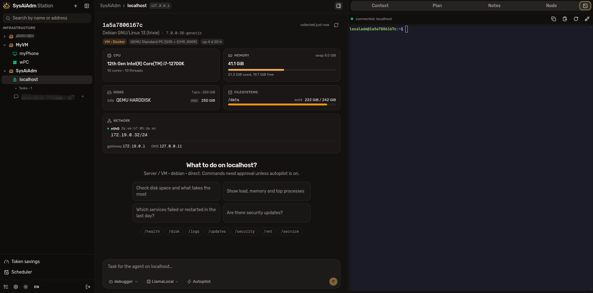

<div align="center">


# SysAiAdm Station

**Восстание машин в помощь админам.**

ИИ-агенты чинят и обслуживают ваши серверы по SSH — а вы смотрите, одобряете и пьёте кофе.

[](LICENSE)


-success)



</div>

---

## Что это

Веб-пульт сисадмина. Один `docker compose up` — и у вас консоль с деревом инфраструктуры, чатом с ИИ-агентом и терминалом. Агенты на базе [OpenCode](https://opencode.ai) V2 выполняют команды на серверах **только по SSH**: на хосты ничего не ставится, ключи и пароли модель не видит никогда.

Рассчитано на 20–40 гипервизоров и 250–300 ВМ: Ubuntu, Debian, Proxmox VE, Windows Server (OpenSSH + PowerShell).

> «Почему место на диске кончилось?», «Какие сервисы падали за сутки?», «Обнови пакеты на всей группе» — пишете задачу, агент разведывает, строит план с откатом и выполняет. Каждая команда видна, опасные — только после вашего «да».

## Возможности

| | |
|---|---|
| 🛡️ **Безопасность прежде всего** | Ключи живут в зашифрованном хранилище (AES-256-GCM) и в процессе sysadm; модель получает только вывод. Guard команд: `deny` / только чтение / `dangerous`. TOFU-пиннинг ключей хоста на каждом хопе. Вход: пароль + TOTP. Полный аудит. |
| 🤖 **Два агента** | **Sysadmin** делает работу (разведка → план с откатом → бэкап конфига → проверка). **Debugger** только читает и ищет причину с доказательствами. Любая модель: облако или свой llama.cpp / Ollama / vLLM. |
| ✅ **Вы контролируете** | Только-чтение выполняется сразу, остальное ждёт: «разрешить раз», «всегда для шаблона», «отклонить». Автопилот на 4 часа — по кнопке ⚡. Кнопка «Стоп» убивает команду на сервере сигналом KILL. |
| 🌳 **Инвентарь деревом** | Компании → группы → гипервизоры → ВМ. Креды, пользователь, порт, скилы и маршрут наследуются от предков. Jump host до 3 хопов. |
| 📥 **Импорт за минуту** | RustConn, Remote Desktop Manager, mRemoteNG, Ansible inventory. Пароли из файлов не берутся никогда. |
| 📇 **Карточка сервера** | `/init` собирает CPU, память, диски, ФС и сеть фиксированным скриптом — без модели и без токенов. |
| ⏳ **Долгие операции не рвутся** | Установки и бэкапы агент запускает в `tmux` (Linux) или задачей планировщика под SYSTEM (Windows). |
| 🧩 **Плагины** | Терминал, планировщик, WireGuard-туннели, маскировка секретов в выводе, сжатие вывода (RTK). Свои — по [docs/plugins.md](docs/plugins.md). |
| 📚 **Скилы** | systemd, диски, логи, сеть, hardening, Proxmox, PowerShell… Свои пишутся в UI или ставятся из GitHub. |
| 🔌 **REST API** | Bearer-токены со scope'ами и сроком — для скриптов, мобилок и других агентов. [docs/api.md](docs/api.md) |
| 🌍 **RU / EN** | Светлая и тёмная тема, акцентный цвет, шрифты. Перевод на свой язык — [docs/i18n.md](docs/i18n.md). |

## Как устроено

```
браузер ──HTTPS──▶ caddy (:443, единственный опубликованный порт)
                     │
                     ▼
                   sysadm (Bun + Hono): SQLite, зашифрованные креды, инвентарь, SSH
                     │  REST к opencode на 127.0.0.1 (дочерний процесс sysadm)
                     ▼
                   opencode serve + плагин sysadm: инструменты remote_exec, web_search
                     │  POST http://127.0.0.1:3001/internal/* (Bearer, новый токен на каждый старт)
                     ▼
                   sysadm выполняет команду по SSH ──▶ [бастион(ы)] ──▶ хост
```

Инварианты:
- Ключи и пароли не попадают в процесс opencode и в контекст модели. SSH и расшифровка — только в процессе sysadm.
- Модель не выбирает хост и маршрут. Плагин передаёт `sessionID` и команду, узел берётся из таблицы задач.
- У агента нет других инструментов, кроме `remote_exec`, `skill`, `question` и (если включён) `web_search`. Shell, webfetch, чтение и правка файлов запрещены политикой.
- Команды проходят guard: `deny` блокирует, `read` (белый список, `apps/server/src/readonly.ts`) идёт без вопроса, `dangerous` всегда требует подтверждения. Regex-проверка best-effort и не даёт гарантии — подтверждение остаётся за вами.
- Каждое действие пишется в аудит.

## Быстрый старт

```sh
git clone <url-репозитория> sysaiadm && cd sysaiadm
cp .env.example .env
echo "SYSADM_MASTER_KEY=$(openssl rand -base64 32)" >> .env   # или впишите вручную
docker compose up -d
```

Откройте `https://localhost`, задайте пароль администратора, отсканируйте TOTP — готово.

> [!IMPORTANT]
> **Потеря `SYSADM_MASTER_KEY` = потеря всех кредов.** Храните его отдельно от тома `sysadm-data`.

> [!NOTE]
> opencode в образ не зашит: при первом старте сервер скачивает последнюю 2.x из npm в `/data/opencode/bin` (~250 МБ, до пары минут). Контейнеру нужен выход на `registry.npmjs.org`; для скилов из GitHub — на `github.com`.

При `SYSADM_TLS=internal` браузер ругнётся на сертификат. Корневой сертификат Caddy: `docker compose cp caddy:/data/caddy/pki/authorities/local/root.crt .`

## Работа с агентом

На узле — «Новая задача», описываете, что нужно. Ответ идёт потоком: команды (клик — полный вывод в цветах терминала), размышления, загрузка скилов, план. У сообщений есть копирование и закрепление в контексте («Pin»). Когда контекст переваливает порог (по умолчанию 180 тыс. токенов), чат предлагает начать новую задачу; старая часть разговора сжимается плагином [DCP](https://www.npmjs.com/package/@tarquinen/opencode-dcp).

Слеш-команды: `/health`, `/disk`, `/logs`, `/updates`, `/security`, `/net`, `/service` и свои в «Настройки → Команды».

Задачи под сервером архивируются, а не удаляются (аудит); архив чистится через 90 дней.

**Встроенный узел `SysAiAdm/localhost`** — сам контейнер станции. На нём агент может посмотреть, что происходит со станцией, и поправить конфиг opencode через `sysadm-oc` — только как `dangerous`-команда с вашим подтверждением. Удалить или перенести этот узел нельзя.

## Модели, агенты, скилы

- **Провайдеры** — ключи облачных провайдеров и свои OpenAI-совместимые (llama.cpp, Ollama, LM Studio, vLLM, шлюз). Ключи хранит opencode и повторно не показывает.
- **Модели** — скрыть лишнее из списков.
- **Агенты** — для Sysadmin и Debugger: модель, уровень мышления, промпт, цвет, лимит шагов.
- **Конфиг opencode** — JSON поверх базового и плагины opencode. `permissions` и `policies` заперты.
- **Скилы** — встроенные взяты из открытых MIT-репозиториев ([skills/NOTICE.md](skills/NOTICE.md)). Отмечаются на узле и наследуются от компании и группы; скилы по ОС подключаются сами.
- **Веб-поиск** — свой SearXNG (нужен `search.formats: [html, json]`) или Exa, Tavily, Firecrawl, Parallel, TinyFish. По умолчанию выключен. Запрос с внутренним IP или адресом из инвентаря отклоняется, каждый поиск — в аудит.

## Плагины

Включаются в «Настройки → Плагины». Каждый — отдельный пакет в `plugins/<id>`.

- **Терминал** — SSH-сессия в правой панели. Копирование: выделение + Ctrl+C или Ctrl+Shift+C, вставка — Ctrl+V (буфер обмена только по HTTPS).
- **Планировщик** — задачи агенту по расписанию: однократно, ежедневно, по дням недели, раз в месяц.
- **WireGuard** — клиентские туннели к площадкам, автозапуск, статус. Нужны `NET_ADMIN` и модуль ядра wireguard.
- **Маскировка секретов** — пароли, токены и приватные ключи в выводе заменяются на `***` до того, как их увидит модель. Сбой маскировки — вывод не отдаётся.
- **Экономия токенов (RTK)** — сжимает длинный вывод и считает статистику.

## Инвентарь и подключение

Узлы: `company`, `group`, `hypervisor`, `vm`. Креды, пользователь, порт и оболочка наследуются от ближайшего предка. Креды назначаются на компанию или группу, а не на каждую ВМ.

**Jump host.** Любой узел может быть бастионом. Режим подключения: `inherit` (от предка), `direct`, `via` (через выбранный узел, до 3 хопов). Каждый хоп — свои креды и **свой** закреплённый ключ хоста (TOFU). Ключ сменился — выполнение отказывает с указанием хопа, сброс только руками («Сбросить ключ хоста»). Ошибки маршрута: `JUMP_CYCLE`, `JUMP_TOO_DEEP`, `JUMP_NO_ADDRESS`.

**Импорт** — предпросмотр, затем применение одной транзакцией. Повторный импорт идемпотентен.

| Источник | Как получить файл |
|---|---|
| RustConn | `rustconn-cli export -f native -o inventory.rcn` |
| Remote Desktop Manager | File → Export → Export All (.json) |
| mRemoteNG | `confCons.xml` **без шифрования** (без `FullFileEncryption`) |
| Ansible | `inventory.ini` или `inventory.yml` |

Пароли из файлов не импортируются никогда; путь к ключу попадает только в заметки узла. Файл до 5 МБ, XML с `<!DOCTYPE`/`<!ENTITY` отклоняется.

**Экспорт и перенос** — правый клик по узлу → «Экспорт…». Всё дерево или ветка в файл `.sysaiadm`, всегда зашифрованный паролем (AES-256-GCM, scrypt, пароль от 12 символов). С галочкой «С паролями и ключами» внутрь попадают учётки.

## Эксплуатация

<details>
<summary><b>Свой nginx вместо caddy</b></summary>

Уберите сервис `caddy` из compose, опубликуйте порт `8080` контейнера `sysadm` (лучше на `127.0.0.1`) или подключите его к сети nginx. Папки хоста вместо томов должны принадлежать uid 1000: `chown -R 1000:1000 /opt/sysadm`.

```yaml
services:
  sysadm:
    build: { context: ., dockerfile: docker/sysadm.Dockerfile }
    restart: unless-stopped
    env_file: .env
    cap_add: [NET_ADMIN]
    environment:
      DB_PATH: /data/sysadm.sqlite
      INFRA_DIR: /infra
    ports:
      - 127.0.0.1:8080:8080
    volumes:
      - /opt/sysadm/data:/data
      - /opt/sysadm/infra:/infra
      # - /mnt/backup/sysadm:/data/backups   # копии базы на другом диске
```

```nginx
location / {
    proxy_pass http://127.0.0.1:8080;
    proxy_http_version 1.1;
    proxy_set_header Host $http_host;              # с портом: терминал сверяет Origin с Host
    proxy_set_header X-Forwarded-For $remote_addr; # не $proxy_add_x_forwarded_for: по нему лимит попыток входа
    proxy_set_header X-Forwarded-Proto $scheme;
    proxy_set_header Upgrade $http_upgrade;        # WebSocket для терминала
    proxy_set_header Connection $connection_upgrade;
    proxy_buffering off;                           # живые события (SSE)
    proxy_read_timeout 1h;
    client_max_body_size 6m;                       # импорт файлов
}
```

`$connection_upgrade` объявляется в `http {}`: `map $http_upgrade $connection_upgrade { default upgrade; '' close; }`. Только HTTPS: cookie сессии с флагом Secure.
</details>

<details>
<summary><b>Бэкап и восстановление</b></summary>

Копии базы делаются сами: раз в 24 часа, хранятся 7 последних, в `/data/backups`, через `VACUUM INTO` без остановки сервиса. Расписание, «Сделать копию сейчас», скачивание — «Настройки → Резервные копии».

Храните отдельно:
- копии базы (или весь том `sysadm-data`);
- `.env` с `SYSADM_MASTER_KEY` — без него копия бесполезна;
- том `infra` можно не сохранять: пересоздаётся из инвентаря при старте.

Восстановление: остановить контейнер, положить копию на место `/data/sysadm.sqlite`, удалить рядом `-wal` и `-shm`, запустить.
</details>

<details>
<summary><b>Обновление opencode</b></summary>

Раз в 6 часов сервер проверяет новую версию `@opencode/cli`. Вышла — справа внизу окошко «Обновить»: скачивание, сверка контрольной суммы, перезапуск. Не поднялась за 60 секунд — откат на прежнюю. Автоматически ставится только 2.x. Если задан `OPENCODE_BIN`, обновления выключены.
</details>

<details>
<summary><b>Подготовка Windows Server</b></summary>

1. Установите OpenSSH Server.
2. Публичный ключ — в `C:\ProgramData\ssh\administrators_authorized_keys`.
3. PowerShell оболочкой по умолчанию:
   ```powershell
   New-ItemProperty -Path "HKLM:\SOFTWARE\OpenSSH" -Name DefaultShell -Value "C:\Program Files\PowerShell\7\pwsh.exe" -PropertyType String -Force
   ```
   Без PowerShell 7 — `C:\Windows\System32\WindowsPowerShell\v1.0\powershell.exe`.
</details>

<details>
<summary><b>Переменные окружения, логи и dev-режим</b></summary>

- `SYSADM_DOMAIN`, `SYSADM_TLS` (`internal` — самоподписанный CA Caddy), `SYSADM_HTTPS_PORT` — TLS и порт.
- `LOG_LEVEL` — `debug` | `info` | `warn` | `error`, по умолчанию `info`. Логи — в `docker logs` и на странице «Система».
- `GITHUB_TOKEN` — необязательно, для установки скилов из GitHub.
- `SYSADM_ENV=dev` — **только для стенда**: отключает проверку TOTP (пароль, лимит попыток, guard, шифрование, TOFU и CSRF остаются). На входе видна плашка «DEV-режим». Любое другое значение, кроме `prod`, роняет сервис.

Чек-лист перед продом: `grep -c '^SYSADM_ENV' .env` → `0`.
</details>

## Разработка

```sh
bun install
bun run dev
bun test            # 400+ тестов
bun run typecheck
bun run build
```

Структура: `apps/server` (Hono API, SQLite, vault, guard, SSH, импорт), `apps/web` (React + shadcn/ui + Tailwind v4), `packages/shared` (общие типы), `packages/plugin` (плагин opencode: `remote_exec`, `web_search`), `plugins/*` (плагины станции), `skills/` (встроенные скилы). Документация: [API](docs/api.md) · [плагины](docs/plugins.md) · [i18n](docs/i18n.md).

Пулл-реквесты приветствуются. Принимая PR, автор просит согласие на двойное лицензирование (см. ниже).

## Лицензия

Copyright © 2026 Aleks ([@aleks-spv](https://github.com/aleks-spv)). Это **Community Edition** под [GNU AGPL-3.0](LICENSE) (`AGPL-3.0-only`): используйте, меняйте и распространяйте свободно, но изменённую версию, которую вы даёте использовать другим (в том числе по сети), нужно публиковать с исходным кодом под той же лицензией.

Для использования без условий AGPL (закрытые доработки, встраивание в коммерческий продукт) автор может выдать коммерческую лицензию.
